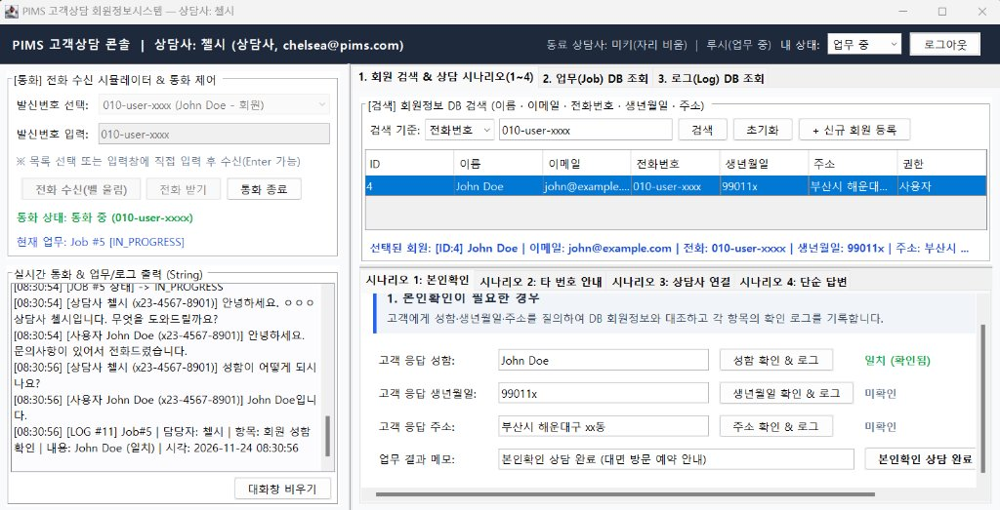

# pims-infott2t-tdd

> ✅ **프로젝트 마무리 (Completed for Now)**  
> 본 학습 및 실습 프로젝트는 현재로서는 여기서 마무리합니다.

## 📌 소개 (Overview)

본 저장소는 학습 및 실습 목적으로 진행하고 있는 프로젝트입니다.  
누구나 **공부하는 용도로 자유롭게 참고하고 사용**하실 수 있으며, 함께 공부하시는 분들께 작은 **도움이 되었으면 좋겠습니다.**

---

## 🖥️ Swing 고객상담 회원정보시스템 (`swing.*`)

콘솔 기반 인터페이스 실습([CProgram2.java](./program/CProgram2.java))의 업무 흐름과 `JobsIF` / `LogsIF` 설계를 계승하여, **Java Swing GUI + MySQL 8.0 JDBC** 기반의 고객상담 회원정보시스템으로 확장한 프로그램입니다.



### ✨ 주요 기능

1. **상담사 로그인 및 권한 관리 (`Role.상담사`)**
   - 이메일·비밀번호 인증 및 `Role.상담사` 권한 검증 (일반 회원 계정 로그인 차단)
   - 상단 헤더에서 본인 상태(`업무 중` / `자리 비움`) 전환 및 동료 상담사 실시간 상태 확인
   - 로그인 화면의 **[DB 연결 설정]** 다이얼로그에서 로컬 MySQL 8.0 접속 정보 테스트·저장 및 DB/테이블/샘플 데이터 자동 초기화 지원

2. **전화 수신 시뮬레이터 & 실시간 통화 제어 (`IncomingCallPanel`)**
   - **발신번호 선택(`JComboBox`)** 또는 **발신번호 입력(`JTextField`)** 두 가지 방식 모두 지원 (Enter 키 수신 가능)
   - 통화 상태 전이(`대기 중` → `벨 울림(INIT)` → `통화 중(IN_PROGRESS)` → `대기(PENDING)` / `종료(COMPLETED)`) 및 실시간 대화·업무·로그 출력

3. **회원정보 DB 검색 — 개인정보 최소화 (`ConsultationPanel`)**
   - 전체 회원 일괄 조회를 비활성화하고, **발신번호(핸드폰 번호)가 정확히 일치하는 회원 1건**의 정보(이름, 이메일, 전화번호, 생년월일, 주소)만 검색 결과 테이블에 표시
   - 신규 회원 DB 등록 기능 지원

4. **상담 시나리오 1~4 처리 (`JobsServiceIF`, `LogsServiceIF`)**
   - **시나리오 1 (본인확인)**: 고객 응답 성함·생년월일·주소를 DB 회원정보와 실시간 대조(`일치`/`불일치`)하고 항목별 로그 기록 후 상담 완료(`COMPLETED`)
   - **시나리오 2 (타 번호 안내)**: 담당 부서 전화번호 안내 및 로그 기록(`logAnotherNumber`) 후 완료(`COMPLETED`)
   - **시나리오 3 (다른 상담사 연결 — 미완성)**: 대상 상담사 상태에 따른 기본 분기(`PENDING` 전환 등)만 반영되어 있으며, 실제 상담사 간 연결 전체 흐름은 완성하지 않았습니다.
   - **시나리오 4 (단순 답변 / 비회원 단순상담)**: 단순 질의응답 로그 기록(`logSimpleAnswer`) 후 완료(`COMPLETED`)

5. **업무(Job) DB 및 로그(Log) DB 조회 (MySQL 8.0)**
   - `roles`, `users`, `jobs`, `logs` 4개 테이블([schema.sql](./swing/db/schema.sql))에 모든 상담 업무와 로그를 영속 저장
   - **2번 탭 (`업무(Job) DB 조회`)**: 상태별 필터링, `PENDING` 업무 후속 완료 처리, 선택 업무 로그 바로가기 지원
   - **3번 탭 (`로그(Log) DB 조회`)**: 관리자 전용 영역으로 기본 비노출 처리되며, 탭 클릭 시 가상 시나리오 안내 팝업 확인 후 열람 가능

### 📂 패키지 구조

```text
pims-tdd/
├── before/       # 리팩토링 이전 초기 콘솔 코드 보관
├── jobs/         # 콘솔 버전 Job 엔티티 및 JobsIF 인터페이스
├── logs/         # 콘솔 버전 Log 엔티티 및 LogsIF 인터페이스
├── users/        # 콘솔 버전 Users, Role 클래스
├── program/      # 콘솔 시나리오 실행기 (CProgram2.java)
├── swing/        # Java Swing + MySQL 8.0 고객상담 회원정보시스템
│   ├── SwingApp.java        # Swing 앱 실행 진입점
│   ├── entity/              # Role, JobStatus, User, Job, Log 엔티티
│   ├── db/                  # DatabaseConfig, DatabaseManager, schema.sql
│   ├── repository/          # User/Job/Log Repository 인터페이스 및 JDBC 구현체
│   ├── service/             # JobsServiceIF, LogsServiceIF, Auth/User/Job/Log Service
│   ├── ui/                  # LoginFrame, DbConfigDialog, MainConsoleFrame 및 패널들
│   └── test/                # SwingServiceTest (서비스/시나리오 자동 검증)
└── docs/images/  # README 실행 화면 캡처 이미지
```

### 🚀 실행 방법

1. **요구 환경**: JDK 17 이상, MySQL 8.0 실행 중, `lib/mysql-connector-j-8.4.0.jar`
2. IDE에서 [`swing/SwingApp.java`](./swing/SwingApp.java)의 `main` 메서드를 실행합니다.
3. 로그인 창에서 **[DB 연결 설정]**을 눌러 로컬 MySQL 접속 정보 입력 후 **[저장 및 DB 초기화]**를 클릭합니다.
4. 테스트 상담사 계정(`chelsea@pims.com` / `1234`)으로 로그인하여 상담 시나리오를 테스트합니다.

### 📝 미완성 항목 및 프로젝트 마무리

- **로그(Log) DB 조회 시 열람 로그 기록 (추후 과제)**: 로그 DB 자체를 조회·열람하는 경우에도 누가 언제 로그를 확인했는지 별도의 조회 로그 기록을 남기도록 확장할 수 있습니다.
- **다른 상담사 연결 시나리오 미완성**: 시나리오 3(다른 상담사 연결) 부분은 완전히 구현하지 않았으며, 기본 상태 전환까지만 반영되어 있습니다.
- **프로젝트 마무리 안내**: 본 프로젝트는 학습 및 실습 목적을 바탕으로 진행되었으며, **현재로서는 여기서 프로젝트를 마무리합니다.**

---

## 🤖 사용된 도구 (AI Tools)

이 프로젝트는 아래의 AI 코딩 어시스턴트 도구들을 활용하여 작성 및 개발되었습니다.

- **Google Antigravity (안티그래비티)**
- **GitHub Copilot**

## ⚠️ 면책 조항 및 주의사항 (Disclaimer)

- 본 프로젝트는 개인적인 상상과 아이디어로 설계·개발된 부분이 많으므로, 실제 서비스나 실무 환경에 적용하기 위해서는 **반드시 전문가의 검토와 도움**이 필요합니다.
- 이 코드를 참고하거나 실제 **상업적 용도로 활용하더라도, 이로 인해 발생하는 어떠한 문제나 손해에 대해서도 작성자는 법적·도의적 책임을 지지 않습니다.** (As-Is 제공)

## 📄 라이선스 (License)

이 프로젝트는 [MIT License](./LICENSE)를 따릅니다.
